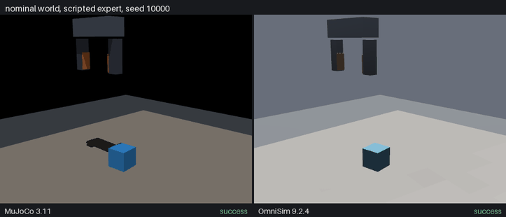
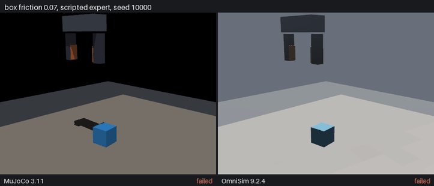
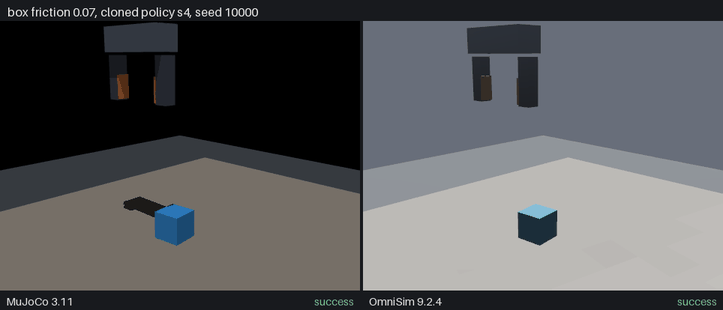
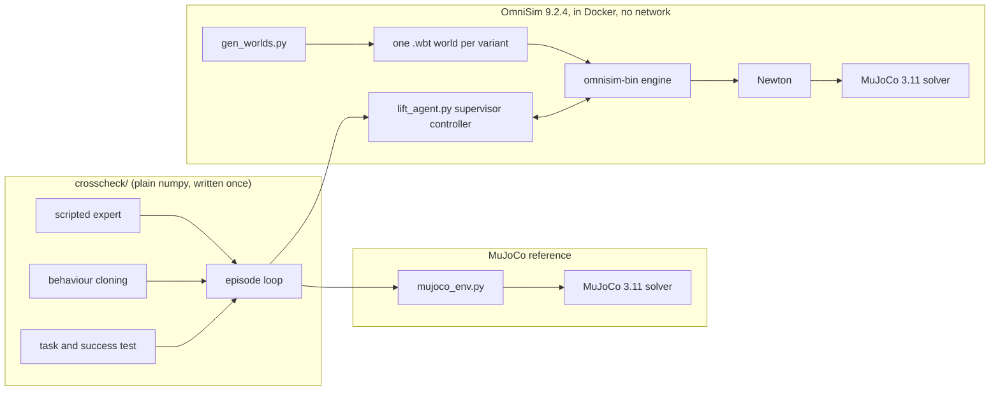

# omnisim-grasp-crosscheck

One small imitation-learning task, run in two simulators with identical
code, then compared after one controlled change to the world.

The task is lift-and-hold from
[ml-grasp-rl-imitation-sim](https://github.com/CGainsWorks/ml-grasp-rl-imitation-sim):
a parallel-jaw hand closes on a 44 mm box and holds it 15 cm above the table.
A scripted expert records 200 demonstrations and five behaviour-cloned
policies are trained from them. All of that runs twice: once in a MuJoCo 3.11
reference and once in [OmniSim](https://github.com/omnilink-tech/omnisim)
v9.2.4, a Webots-derived simulator whose physics is Newton driving the same
MuJoCo solver. The controlled change is box friction lowered from 1.0 to 0.07.
It was chosen on MuJoCo and written down, with five predictions, before
OmniSim ran any changed world ([preregistration](docs/preregistration.md)).

**What came out.** Three of the five predictions held and two failed.
- **Easy case:** in the nominal world both simulators agree completely. Experts and clones score 1.00 in each and each simulator's clones score 1.00 when run in the other.
- **Agrees on the cliff:** on low friction, the clone beats the expert it was cloned from in *both* simulators. That is the result that survives the change of simulator.
- **Disagrees on the cliff:** the cliff itself is in a different place. MuJoCo drops off a step between friction 0.08 and 0.07. OmniSim slopes down from 0.15 to 0.06.

Two candidate causes found in OmniSim's source were tested and neither
explains it ([findings](docs/findings.md)). Before anything ran, the
simulator's source was read for malicious code and it was then built from
that source and run without network access ([security review](docs/security-review.md)).

## See it

Each clip is one held-out starting state (seed 10000) played out in both
simulators and filmed from the same camera pose: MuJoCo on the left, OmniSim
on the right. The OmniSim frames come from a Camera device inside the engine.
The caption is the outcome that episode actually had, which matches the
committed results.

**The nominal world.** The scripted expert approaches, closes and lifts. Both
simulators hold the box at the hold point.



**Box friction 0.07, the scripted expert.** The same starting state with the
box made slippery. The expert closes for a fixed time and lifts. In both
simulators the box slips down through the fingers and the episode fails.



**Box friction 0.07, a cloned policy.** The same starting state again, with one
of the five behaviour-cloned policies trained from that expert's
demonstrations. It succeeds in both simulators, which is the clone beating its
teacher.



Rebuild them with `python scripts/render_media.py` (needs Docker, the OmniSim
image and `pip install -r requirements-media.txt`).

## How OmniSim was used

OmniSim is driven the same way as the MuJoCo reference: through a plain
`reset` and `step` interface, from the same task, expert and policy code. The
only OmniSim-specific pieces are a world generator and a supervisor controller
that runs inside the engine.



The engine is built from the audited upstream source by
`scripts/build_omnisim_image.sh`. `scripts/run_omnisim.py` starts one
container per chunk of seeds with `run-headless`, the repository mounted read
only and results written to a named volume. Inside, the controller places the
box, drives the gantry to its start pose and then runs the episode loop
through OmniSim's motors, sensors and supervisor API.

## Results

Success rate over 100 held-out initial states per world. Clones are the five
behaviour-cloned policies, each trained in the simulator it is evaluated in,
shown as the mean with the range across the five. The bold row is the
preregistered change; the others locate the friction cliff and test mass.

<!-- results:start -->
| world | MuJoCo expert | MuJoCo clones | OmniSim expert | OmniSim clones |
| --- | ---: | ---: | ---: | ---: |
| nominal | 1.00 | 1.00 (1.00 to 1.00) | 1.00 | 1.00 (1.00 to 1.00) |
| box friction 0.30 | 1.00 | 1.00 (1.00 to 1.00) | 1.00 | 0.99 (0.98 to 0.99) |
| box friction 0.15 | 1.00 | 1.00 (1.00 to 1.00) | 0.99 | 0.95 (0.93 to 0.97) |
| box friction 0.08 | 0.94 | 0.92 (0.73 to 0.98) | 0.52 | 0.71 (0.59 to 0.83) |
| **box friction 0.07** | 0.02 | 0.48 (0.12 to 0.87) | 0.52 | 0.71 (0.38 to 0.85) |
| box friction 0.06 | 0.00 | 0.00 (0.00 to 0.00) | 0.03 | 0.54 (0.09 to 0.71) |
| box mass 4x | 1.00 | 1.00 (1.00 to 1.00) |  |  |
| box mass 10x | 1.00 | 1.00 (0.99 to 1.00) | 1.00 | 1.00 (1.00 to 1.00) |
<!-- results:end -->

### The predictions

Written before the OmniSim runs and graded mechanically by
[`scripts/summarise.py`](scripts/summarise.py).

<!-- predictions:start -->
| | claim | observed in OmniSim | verdict |
| --- | --- | --- | --- |
| P1 | In the nominal OmniSim world the expert scores at least 0.95 and the mean of the five OmniSim-trained clones at least 0.90. | expert 1.00, mean clone 1.00 | **held** |
| P2 | At friction_0.07 in OmniSim the expert scores below 0.50. | expert 0.52 | **failed** |
| P3 | At friction_0.07 in OmniSim the mean clone scores above the expert. | mean clone 0.71 against expert 0.52 | **held** |
| P4 | mass_x10 moves neither the expert nor the mean clone by more than 0.05 from nominal in OmniSim. | expert moves 0.00, mean clone moves 0.00 | **held** |
| P5 | The friction cliff (the step from expert >= 0.90 to expert <= 0.10) lies between 0.08 and 0.06 in OmniSim too. Weakest of the five: the scenes share the MuJoCo solver but not the contact softness, which OmniSim sets per world rather than per geom. | expert 0.52 at 0.08, 0.03 at 0.06 | **failed** |
<!-- predictions:end -->

### Policies moved between simulators

Each simulator's five clones, run unchanged in the other one.

<!-- transfer:start -->
| world | MuJoCo clones run in OmniSim | OmniSim clones run in MuJoCo |
| --- | ---: | ---: |
| nominal | 1.00 (1.00 to 1.00) | 1.00 (1.00 to 1.00) |
| box friction 0.07 | 0.56 (0.42 to 0.81) | 0.21 (0.10 to 0.45) |
<!-- transfer:end -->

## What this is for

A policy result that holds in one simulator is a claim about that
simulator as much as about the policy. This repository is a small, complete
pattern for checking that:
- the task, expert, learner and episode loop written once and run unchanged in two engines
- the change fixed and the predictions written down before the second engine runs
- the comparison graded by a script, not by eye

It is the step before trusting a new simulator for a task, or before
spending hardware time on a result that only one engine has produced.

For OmniSim in particular it is the bounded test the OmniLink team asked
for: one small training task recreated, one controlled environment change
and candid notes on where it became unclear. Those notes are in
[docs/findings.md](docs/findings.md) §4.

## How it fits together

| path | what it is |
| --- | --- |
| `crosscheck/` | the task, the expert, numpy behaviour cloning and the episode loop; plain numpy, imported unchanged by both simulators |
| `scenes/lift.xml`, `crosscheck/mujoco_env.py` | the MuJoCo reference |
| `omnisim/gen_worlds.py`, `omnisim/worlds/` | one OmniSim world per variant, generated (OmniSim fixes mass and friction at load) |
| `omnisim/controllers/lift_agent/` | the OmniSim supervisor controller: the same `reset` and `step` interface as the MuJoCo env |
| `scripts/run_omnisim.py` | runs jobs in network-less containers in parallel and merges the results in seed order |
| `results/` | raw per-episode results, policies, demonstrations, the preregistration and the generated summary |
| `scripts/render_media.py`, `crosscheck/camera.py`, `media/` | the side-by-side clips: one camera pose for both simulators, the OmniSim `_render` worlds and the GIFs |

The hand rides a three-axis gantry of position-servoed prismatic joints in
both scenes. The original repository uses a mocap weld, which OmniSim has no
direct equivalent for, so the gantry keeps the two scenes describing the same
mechanism.

## Reproducing it

The MuJoCo side needs only Python:

```bash
pip install -r requirements.txt
```
```bash
python scripts/run_mujoco.py --variants nominal friction_0.30 friction_0.15 friction_0.08 friction_0.07 friction_0.06 mass_x4 mass_x10 --out results/mujoco
```

The OmniSim side needs Docker. Build the engine from the audited commit, then
run the three stages:

```bash
bash scripts/build_omnisim_image.sh
```
```bash
python scripts/run_omnisim_eval.py --stage demos
```
```bash
python scripts/run_omnisim_eval.py --stage train
```
```bash
python scripts/run_omnisim_eval.py --stage eval
```

Then `python scripts/run_transfer_mujoco.py` and `python scripts/summarise.py`
rebuild the tables above. The OmniSim stages take under an hour with twelve
containers on a 16-core machine.

CI runs lint, the tests, a world-file freshness check, the table check and a
25-episode MuJoCo reproduction on every push. Building OmniSim and running it
in the engine is a manual job (`workflow_dispatch` with `omnisim` ticked),
because the build is the cost and it does not change when this repository
does.

## Limitations

- One task, one expert and one learner. The cliff result is about this
  grasp with these gains, not about grasping in general.
- 100 episodes per cell and five clones. A difference of a few points
  between cells is noise. The interval on a single 100-episode rate is about
  plus or minus 0.10 at 0.5.
- The mechanism behind the clone beating its teacher and the cause of the
  moved cliff, are both open ([findings](docs/findings.md)).
- Simulation only. Nothing here has touched hardware and neither simulator is
  evidence about a real gripper.
- OmniSim's plain-language scene feature was not tested: it needs the paid
  agent and an account.

## Licence

MIT. OmniSim is Apache-2.0 and is not redistributed here: it is cloned and
built at run time.
